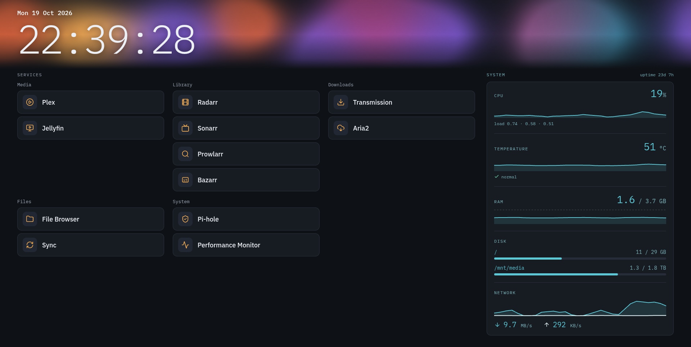
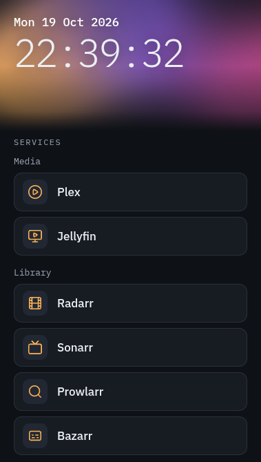

# RPi Homepage

A *(formerly Flask-based)* Fastapi-based dashboard for my RaspberryPi

## Background

Since I bought a Raspberry Pi 4, I started installing a lot *(and I mean a lot)* of services, to the point I had to move some of them to another embedded device *(an Odroid, this time)*.
As of now, shared between the two devices, the following services are running:

- Plex
- Jellyfin
- Radarr, Sonarr, Prowlarr and Bazarr
- Transmission
- Aria2
- File Browser
- PiHole
- probably some more that I can't even remember right now.

Given the premises, you can imagine how I could never remember the URL path and the port of each service, let alone their IP address.

So this is how the RPi homepage was born. It's a simple, quick, easy way to connect to some important service and why not, keep an eye on how the Pi is doing in a clean-looking, minimal, interface?
The webpage is completely scalable as I have tested it on many devices and screen resolutions.

## Code structure

This whole backend is coded in Python using the Fastapi framework.
I moved from Flask to Fastapi because the GitHub dependency bot was complaining about some security issues in the Flask codebase, I could not find a way to structure the code in an OOP style.

The backend is split into a few small modules:

- `rpiserver` creates the Fastapi app, its routes and the scheduled jobs
- `settings` loads the whole configuration from a single toml file
- `system` periodically samples the host resources through [psutil](https://github.com/giampaolo/psutil) and keeps a short history of them
- `icons` downloads the icons of the services and caches them on disk
- `logs` routes every log *(uvicorn and apscheduler included)* through [loguru](https://github.com/Delgan/loguru)

The front end is written in vanilla JS, without any build step.
Previously, I wrote it all in jQuery but let's be honest, in nova days it's useless as Javascript has evolved enough to include css selectors for DOM elements (can you imagine!), callbacks (unbelievable!), and HTTP requests (no more Ajax!).
Furthermore, CSS itself now supports transitions and animations, thus making jQuery even more useless.

### Homepage

My goal was to make a simple, clean, minimal page that could display the most important information at a glance.
To accomplish this, I divided the page into 3 sections:

1. the top section, displaying the date and time
2. the services section, displaying the links to the services, grouped by category
3. the system section, displaying the status of the host

Behind the clock, a few coloured blobs slowly float around.
They are drawn by a tiny WebGL shader, rendered at a fraction of the resolution *(they are blurry anyway)* and capped at 30 fps, so that the page doesn't keep the CPU busy.
This replaced the random Unsplash background of the previous version: no more API keys, and no more images that make the text unreadable.

Each service gets an icon from the [Lucide](https://lucide.dev/icons) set.
Icons are downloaded the first time they are needed and then served from a local cache, so the page keeps working even without an internet connection.

The links point to the LAN address of the service when the page is opened from the local network, and to the VPN address otherwise.
The local networks are customisable in the settings file.

### System status

The system section shows:

- CPU usage and load average
- CPU temperature, with a warning when it gets too hot
- RAM usage
- disk usage of the configured mount points
- download and upload speed

The resources are sampled in the background at a fixed interval, and the recent history is drawn as a small chart for each of them.
The page fetches the data from the `/get/system` endpoint and refreshes itself at the same interval.

### Deployment

Thanks to the Fastapi framework, the code can be deployed in many ways.
I am currently using the built-in Uvicorn server: while a more reliant and more robust web server such as Nginx could be used, I don't think it's necessary for this project.
Uvicorn is good enough to handle all the extremely few requests that this project will receive.

If the homepage sits behind a reverse proxy anyway, its address can be added to `forwarded_allow_ips` in the settings, so that the real client IP *(and therefore the LAN/VPN choice)* is still detected correctly.

## Installation

First of all, you have to:

1. Clone or download this repo on your computer
1. Navigate to the `rpi-homepage/settings/` folder
1. Rename `settings.example.toml` to `settings.toml` and complete it with all the necessary information
   - add a `[[Links]]` table for each service you want to display

Then, you can either run it in a container or directly on the host.

### Docker

1. Go back to the main folder
1. Build and start the container with `docker compose up -d --build`
1. Open your browser and navigate to `http://localhost:1234` *(or whatever port you set in the settings file)*
1. Done!

The container uses host networking, so that the app can see the real IP of the clients and the network speed of the host.
The settings folder is mounted read-only and the icons are cached in a named volume, so they survive a rebuild.
Remember to change the `TZ` variable in `compose.yaml` to your timezone.

### Without Docker

1. Go back to the main folder
1. Install the dependencies with `uv sync` *(requires [uv](https://docs.astral.sh/uv/))*
1. Navigate to the `rpi-homepage/` folder
1. Run the script with `uv run rpi-homepage.py`
1. Open your browser and navigate to `http://localhost:1234` *(or whatever port you set in the settings file)*
1. Done!

## Screenshots

## License

This project is distributed under the MIT license. See [LICENSE.md](LICENSE.md) for more information.
